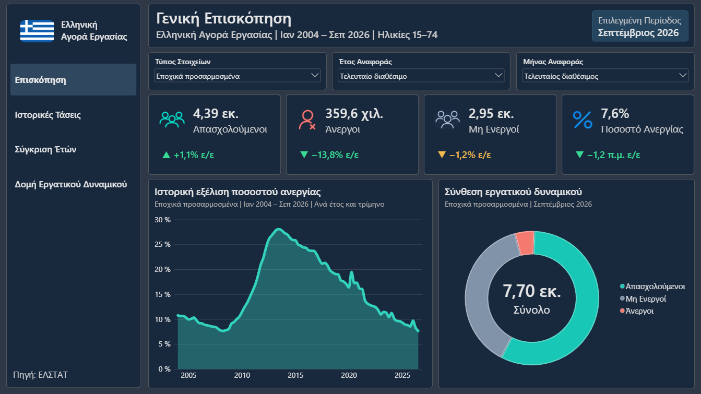
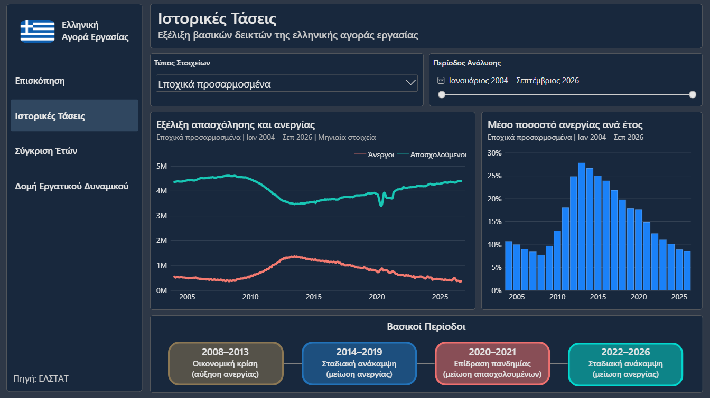
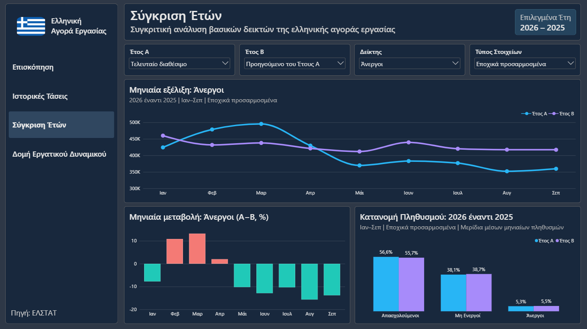
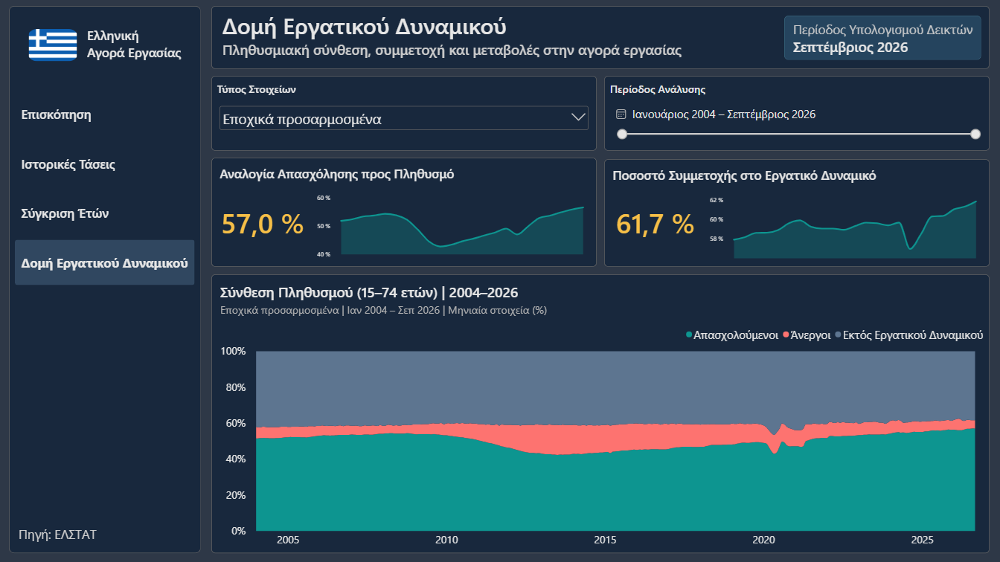
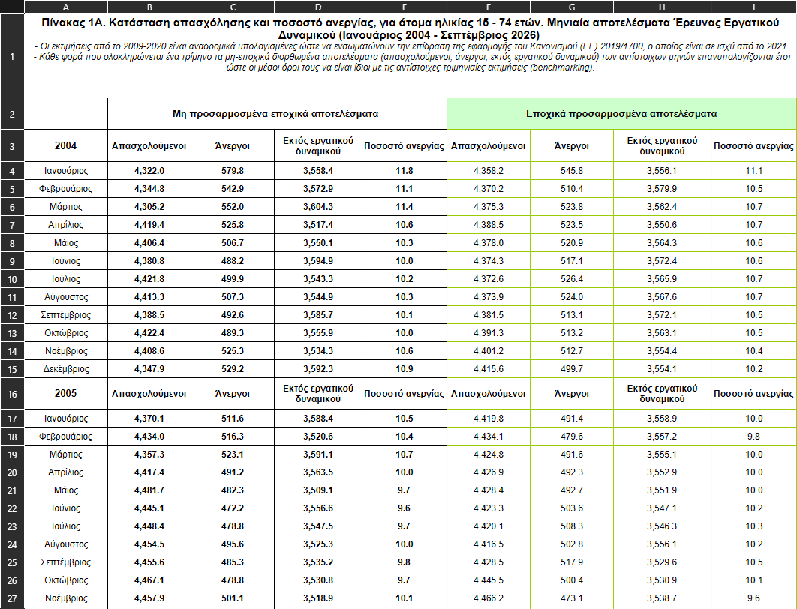
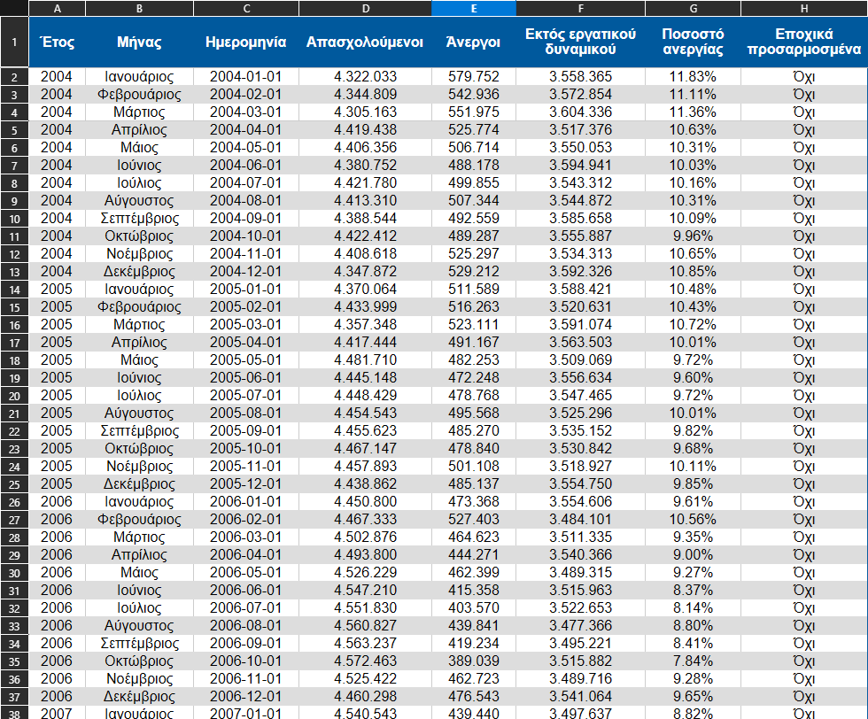

# Ανάλυση της Ελληνικής Αγοράς Εργασίας

**Γλώσσα τεκμηρίωσης:** 🇬🇧 [English](README.md) | 🇬🇷 **Ελληνικά**

---

## Επισκόπηση

Ένας **διαδραστικός πίνακας ελέγχου στο Power BI** που παρουσιάζει πώς έχει αλλάξει η ελληνική αγορά εργασίας από τον **Ιανουάριο του 2004 έως τον Σεπτέμβριο του 2026**, με μηνιαία στοιχεία της **Ελληνικής Στατιστικής Αρχής (ΕΛΣΤΑΤ)**.

Το έργο ξεκινά από τους αρχικούς πίνακες Excel της ΕΛΣΤΑΤ, οργανώνει τα δεδομένα σε μορφή κατάλληλη για ανάλυση και τα παρουσιάζει σε **τέσσερις σελίδες**. Εξετάζονται η απασχόληση, η ανεργία, ο πληθυσμός εκτός εργατικού δυναμικού, οι εποχικές προσαρμογές, οι συγκρίσεις ετών και η σύνθεση του πληθυσμού **15–74 ετών**. Ο πίνακας ελέγχου είναι στα ελληνικά.

Στόχος είναι να μη μένουμε μόνο σε ένα ποσοστό ανεργίας, αλλά να βλέπουμε **τι άλλαξε, πότε άλλαξε και πώς συνδέονται οι διαφορετικές κατηγορίες της αγοράς εργασίας**.

---

## Περιεχόμενα

- [Επισκόπηση](#επισκόπηση)
- [Προεπισκοπήσεις του πίνακα ελέγχου](#προεπισκοπήσεις-του-πίνακα-ελέγχου)
- [Παρουσίαση του έργου](#παρουσίαση-του-έργου)
- [Βασικά ευρήματα](#βασικά-ευρήματα)
  - [Η οικονομική κρίση και η κορύφωση της ανεργίας](#η-οικονομική-κρίση-και-η-κορύφωση-της-ανεργίας)
  - [Η πανδημία: απώλεια απασχόλησης και αύξηση των μη ενεργών](#η-πανδημία-απώλεια-απασχόλησης-και-αύξηση-των-μη-ενεργών)
  - [Η ανάκαμψη και τα πιο πρόσφατα στοιχεία](#η-ανάκαμψη-και-τα-πιο-πρόσφατα-στοιχεία)
  - [Πόσοι συμμετέχουν στην αγορά εργασίας;](#πόσοι-συμμετέχουν-στην-αγορά-εργασίας)
- [Λειτουργίες του πίνακα ελέγχου](#λειτουργίες-του-πίνακα-ελέγχου)
  - [Σελίδες και διαδραστικά γραφήματα](#σελίδες-και-διαδραστικά-γραφήματα)
  - [Φίλτρα, δυναμικές ετικέτες και συγκρίσεις](#φίλτρα-δυναμικές-ετικέτες-και-συγκρίσεις)
- [Πηγή δεδομένων](#πηγή-δεδομένων)
- [Καθαρισμός και προετοιμασία δεδομένων](#καθαρισμός-και-προετοιμασία-δεδομένων)
  - [Πριν και μετά τον καθαρισμό](#πριν-και-μετά-τον-καθαρισμό)
- [Εργαλεία και τεχνικές](#εργαλεία-και-τεχνικές)
- [Δομή έργου](#δομή-έργου)
- [Επόμενα βήματα](#επόμενα-βήματα)
- [Κατάσταση του έργου](#κατάσταση-του-έργου)

---

## Προεπισκοπήσεις του πίνακα ελέγχου

Οι τέσσερις σελίδες έχουν κοινό σκούρο μπλε σχεδιασμό και ελληνικές ονομασίες. **Πατήστε σε οποιαδήποτε εικόνα για να τη δείτε σε πλήρες μέγεθος.**

<table>
  <tr>
    <th align="center" width="50%">Γενική Επισκόπηση</th>
    <th align="center" width="50%">Ιστορικές Τάσεις</th>
  </tr>
  <tr>
    <td align="center" valign="middle"><a href="assets/dashboard-overview.png"></a></td>
    <td align="center" valign="middle"><a href="assets/dashboard-historical-trends.png"></a></td>
  </tr>
  <tr>
    <td align="center"><sub>Τελευταίες τιμές, ετήσιες μεταβολές και κατανομή πληθυσμού</sub></td>
    <td align="center"><sub>Μηνιαίες τάσεις και μέσο ποσοστό ανεργίας ανά έτος</sub></td>
  </tr>
  <tr>
    <th align="center">Σύγκριση Ετών</th>
    <th align="center">Δομή Εργατικού Δυναμικού</th>
  </tr>
  <tr>
    <td align="center" valign="middle"><a href="assets/dashboard-year-comparison.png"></a></td>
    <td align="center" valign="middle"><a href="assets/dashboard-workforce-structure.png"></a></td>
  </tr>
  <tr>
    <td align="center"><sub>Σύγκριση οποιωνδήποτε δύο ετών σε τέσσερις δείκτες</sub></td>
    <td align="center"><sub>Πώς κατανέμεται ο πληθυσμός σε εργαζομένους, ανέργους και μη ενεργούς</sub></td>
  </tr>
</table>

---

## Παρουσίαση του έργου

Το σύνολο δεδομένων καλύπτει **273 μήνες** (Ιανουάριος 2004–Σεπτέμβριος 2026), με **δύο σειρές για κάθε μήνα**, εποχικά προσαρμοσμένη και μη προσαρμοσμένη, δηλαδή **546 εγγραφές μήνα/σειράς**.

| Δείκτης | Σεπτέμβριος 2026, εποχικά προσαρμοσμένα |
| --- | ---: |
| **Απασχολούμενοι** | **4.391.208** (~4,39 εκατ.) |
| **Άνεργοι** | **359.609** (~359,6 χιλ.) |
| **Εκτός εργατικού δυναμικού** | **2.949.072** (~2,95 εκατ.) |
| **Ποσοστό ανεργίας** | **7,6%** |
| **Ποσοστό συμμετοχής στο εργατικό δυναμικό** *(υπολογισμός)* | **61,7%** |
| **Αναλογία απασχόλησης προς πληθυσμό** *(υπολογισμός)* | **57,0%** |

Τα τέσσερα πρώτα μεγέθη προέρχονται από τη **μηνιαία δημοσίευση της ΕΛΣΤΑΤ για τον Σεπτέμβριο 2026**. Τα δύο τελευταία υπολογίζονται από τις τρεις κατηγορίες πληθυσμού. **Για το 2026 υπάρχουν προς το παρόν μόνο τα στοιχεία Ιανουαρίου–Σεπτεμβρίου.** Τα ποσοστά σύνθεσης αφορούν τον **πληθυσμό αναφοράς 15–74 ετών**, όχι όλους τους κατοίκους της Ελλάδας.

---

## Βασικά ευρήματα

Τα παρακάτω βασίζονται στα **εποχικά προσαρμοσμένα μηνιαία στοιχεία**, εκτός αν αναφέρεται κάτι διαφορετικό. Όπου χρειάζεται, τα μεγέθη είναι στρογγυλοποιημένα. Οι ετήσιες τιμές είναι μέσοι όροι μηνών, **όχι αθροίσματα** ατόμων από διαφορετικούς μήνες.

### Η οικονομική κρίση και η κορύφωση της ανεργίας

Η οικονομική κρίση επηρέασε πολύ έντονα την ελληνική αγορά εργασίας. Στη **σημερινή χρονοσειρά, το υψηλότερο ποσοστό ανεργίας ήταν 28,3% τον Ιούλιο του 2013**, όταν οι άνεργοι ήταν περίπου **1,37 εκατομμύρια** και οι απασχολούμενοι μόλις **3,46 εκατομμύρια**.

Για σύγκριση, τον **Ιούλιο του 2008** η ανεργία βρισκόταν στο **7,6%**, με περίπου **379.800 ανέργους** και **4,59 εκατομμύρια απασχολουμένους**. Μέχρι τον Ιούλιο του 2013, οι απασχολούμενοι είχαν μειωθεί κατά περίπου **1,13 εκατομμύρια**, ενώ το ποσοστό ανεργίας είχε αυξηθεί κατά **20,7 ποσοστιαίες μονάδες**.

Αυτή είναι και η μεγαλύτερη αλλαγή που ξεχωρίζει στο ιστορικό γράφημα: μεγάλη μείωση της απασχόλησης και ταυτόχρονη εκτόξευση της ανεργίας. Τα συγκεκριμένα μεγέθη προέρχονται από την έκδοση των στοιχείων που χρησιμοποιεί το έργο. Παλαιότερες δημοσιεύσεις μπορεί να διαφέρουν λίγο λόγω αναθεωρήσεων.

### Η πανδημία: απώλεια απασχόλησης και αύξηση των μη ενεργών

Η πανδημία έφερε μια διαφορετική εικόνα. Αν συγκρίνουμε τους **ετήσιους μέσους όρους των εποχικά προσαρμοσμένων μηνιαίων στοιχείων**, το ποσοστό ανεργίας ήταν περίπου **17,9% το 2019** και **17,6% το 2020**, δηλαδή *λίγο χαμηλότερο*, παρότι η απασχόληση μειώθηκε αισθητά.

| Ετήσιος μέσος όρος μηνιαίων στοιχείων | 2019 | 2020 | Περίπου μεταβολή |
| --- | ---: | ---: | ---: |
| **Απασχολούμενοι** | 3,89 εκατ. | 3,70 εκατ. | **−183.000** |
| **Εκτός εργατικού δυναμικού** | 3,20 εκατ. | 3,40 εκατ. | **+200.000** |
| **Ποσοστό ανεργίας** | 17,9% | 17,6% | **−0,3 ποσοστιαίες μονάδες** |

Η αλλαγή φαίνεται ακόμη πιο καθαρά από τον **Φεβρουάριο έως τον Μάιο του 2020**: οι απασχολούμενοι έπεσαν από περίπου **3.849.300 σε 3.392.600** (**−456.700**), ενώ οι μη ενεργοί αυξήθηκαν από **3.330.100 σε 3.672.900** (**+342.800**). **Το μηνιαίο ποσοστό ανεργίας πάντως αυξήθηκε** στο ίδιο διάστημα, από **15,8% σε 19,6%**.

Το ενδιαφέρον συμπέρασμα είναι ότι **μόνο το ποσοστό ανεργίας δεν αρκούσε για να δείξει όλη την αναστάτωση**. Σε ξεχωριστή τριμηνιαία ανακοίνωση, η ΕΛΣΤΑΤ κατέγραψε **16,7% ανεργία στο β΄ τρίμηνο του 2020 έναντι 16,9% στο β΄ τρίμηνο του 2019**, ενώ η απασχόληση είχε μειωθεί κατά **2,8%** και οι μη ενεργοί είχαν αυξηθεί κατά **3,4%**. Όποιος δεν εργάζεται και δεν αναζητά ενεργά δουλειά ή δεν είναι διαθέσιμος να ξεκινήσει εργασία δεν υπολογίζεται ως άνεργος, αλλά ως μη ενεργός. Επίσης, οι προσωρινές απουσίες από τη δουλειά περιπλέκουν την εικόνα. **Τα συνολικά στοιχεία δεν μας δείχνουν την πορεία συγκεκριμένων ανθρώπων** από τη μία κατηγορία στην άλλη.

### Η ανάκαμψη και τα πιο πρόσφατα στοιχεία

Από το υψηλότερο σημείο της κρίσης μέχρι τον **Σεπτέμβριο του 2026**, η εποχικά προσαρμοσμένη ανεργία μειώθηκε από **28,3% σε 7,6%**, πτώση **20,7 ποσοστιαίων μονάδων**. Οι απασχολούμενοι αυξήθηκαν από περίπου **3,46 σε 4,39 εκατομμύρια** (περίπου **927.000 περισσότεροι**), ενώ οι άνεργοι μειώθηκαν από περίπου **1,37 εκατομμύρια σε 359.600**.

Η πρόσφατη σύγκριση με τον προηγούμενο χρόνο είναι επίσης θετική. Τον **Σεπτέμβριο του 2026**, σε σχέση με τον **Σεπτέμβριο του 2025**, υπήρχαν **49.573 περισσότεροι απασχολούμενοι (+1,1%)**, **57.627 λιγότεροι άνεργοι (−13,8%)** και το ποσοστό ανεργίας είχε πέσει κατά **1,2 ποσοστιαίες μονάδες**, από **8,8% σε 7,6%**.

Η ανεργία έχει πλέον πλησιάσει **τα προ κρίσης επίπεδα** (για παράδειγμα, 7,6% τον Ιούλιο του 2008). Αυτό δεν σημαίνει ότι όλα έχουν γίνει όπως πριν: ο συνολικός αριθμός απασχολουμένων αλλά και το μέγεθος και η σύνθεση του πληθυσμού αναφοράς έχουν αλλάξει μέσα στα χρόνια.

### Πόσοι συμμετέχουν στην αγορά εργασίας;

Τον **Σεπτέμβριο του 2026**, οι τρεις κατηγορίες του συνόλου δεδομένων αθροίζονται σε περίπου **7,70 εκατομμύρια άτομα ηλικίας 15–74 ετών**:

| Κατηγορία | Άτομα | Ποσοστό πληθυσμού αναφοράς |
| --- | ---: | ---: |
| **Απασχολούμενοι** | 4.391.208 | **57,0%** |
| **Άνεργοι** | 359.609 | **4,7%** |
| **Εκτός εργατικού δυναμικού** | 2.949.072 | **38,3%** |
| **Σύνολο** | **7.699.889** | **100,0%** |

Οι απασχολούμενοι και οι άνεργοι μαζί αποτελούν το **εργατικό δυναμικό**: περίπου **4,75 εκατομμύρια άτομα, δηλαδή το 61,7% του πληθυσμού αναφοράς**. Το υπόλοιπο **38,3%** βρίσκεται εκτός εργατικού δυναμικού. Σε αυτή την ομάδα μπορεί να ανήκουν φοιτητές, συνταξιούχοι, άνθρωποι που φροντίζουν την οικογένειά τους και άλλοι που δεν εργάζονται ούτε αναζητούν ενεργά και είναι διαθέσιμοι για εργασία. **Το συγκεκριμένο αρχείο δεν μας λέει τους επιμέρους λόγους της μη συμμετοχής τους.**

Μια σημαντική διαφορά: το **4,7%** είναι οι άνεργοι *ως ποσοστό ολόκληρου του πληθυσμού αναφοράς*, ενώ το επίσημο **7,6%** είναι το *ποσοστό ανεργίας*, που υπολογίζεται μόνο πάνω στο εργατικό δυναμικό (απασχολούμενοι + άνεργοι). Δεν είναι το ίδιο μέγεθος.

---

## Λειτουργίες του πίνακα ελέγχου

### Σελίδες και διαδραστικά γραφήματα

| Σελίδα / Λειτουργία | Τι παρουσιάζει | Προεπισκόπηση |
| --- | --- | --- |
| **Γενική Επισκόπηση** | Τέσσερις κάρτες KPI για απασχόληση, ανεργία, μη ενεργούς και ποσοστό ανεργίας, ετήσιες μεταβολές, ιστορικό γράφημα ανεργίας και διάγραμμα δακτυλίου για τη σύνθεση του επιλεγμένου μήνα. | [Προβολή σελίδας](assets/dashboard-overview.png) |
| **Ιστορικές Τάσεις** | Μηνιαία εξέλιξη απασχόλησης και ανεργίας, μέσο ποσοστό ανεργίας ανά έτος, επιλογή χρονικού διαστήματος και σημειώσεις για σημαντικές ιστορικές περιόδους. | [Προβολή σελίδας](assets/dashboard-historical-trends.png) |
| **Σύγκριση Ετών** | Επιλογή Έτους Α και Έτους Β, εναλλαγή τεσσάρων δεικτών, μηνιαίες καμπύλες, ραβδόγραμμα θετικών/αρνητικών μεταβολών και σύγκριση ποσοστών πληθυσμιακών κατηγοριών. Για ελλιπή έτη συγκρίνονται **οι ίδιοι διαθέσιμοι μήνες**. | [Προβολή σελίδας](assets/dashboard-year-comparison.png) |
| **Δομή Εργατικού Δυναμικού** | 100% σωρευμένο διάγραμμα περιοχής για τη σύνθεση απασχολουμένων, ανέργων και μη ενεργών, μαζί με μικρούς δείκτες και γραφήματα τάσης για τη συμμετοχή στο εργατικό δυναμικό και την αναλογία απασχόλησης προς πληθυσμό. | [Προβολή σελίδας](assets/dashboard-workforce-structure.png) |

### Φίλτρα, δυναμικές ετικέτες και συγκρίσεις

- **Εποχική προσαρμογή:** Εναλλαγή ανάμεσα σε *Εποχικά προσαρμοσμένα* και *Μη εποχικά προσαρμοσμένα* στοιχεία.
- **Επιλογή έτους και μήνα:** Στη Γενική Επισκόπηση αλλάζουν οι τιμές των KPI και του διαγράμματος δακτυλίου, με προεπιλογή τα τελευταία διαθέσιμα στοιχεία.
- **Περίοδος ανάλυσης:** Επιλογή χρονικού εύρους στις Ιστορικές Τάσεις και στη Δομή Εργατικού Δυναμικού.
- **Έτος Α / Έτος Β / δείκτης:** Σύγκριση δύο διαθέσιμων ετών με κριτήριο απασχολουμένους, ανέργους, πληθυσμό εκτός εργατικού δυναμικού ή ποσοστό ανεργίας.
- **Σωστές μονάδες μέτρησης:** Οι διαφορές των ποσοστών ανεργίας δίνονται σε **ποσοστιαίες μονάδες (π.μ.)**, ενώ οι σχετικές μεταβολές πληθυσμιακών μεγεθών σε **ποσοστά (%)**.
- **Δυναμικοί τίτλοι, υπότιτλοι και τιμές:** Οι ετικέτες αλλάζουν ανάλογα με το χρονικό διάστημα, τον τύπο στοιχείων και τον επιλεγμένο δείκτη. Οι μεγάλοι αριθμοί εμφανίζονται σε χιλιάδες ή εκατομμύρια για πιο εύκολη ανάγνωση.
- **Κοινός σχεδιασμός:** Πλοήγηση στα ελληνικά, σκούρο μπλε θέμα και σταθερά χρώματα για τις πληθυσμιακές κατηγορίες.

---

## Πηγή δεδομένων

**Κύρια πηγή:** [Ελληνική Στατιστική Αρχή (ΕΛΣΤΑΤ)](https://www.statistics.gr/) | *Έρευνα Εργατικού Δυναμικού, μηνιαία στοιχεία*

- [01A. Κατάσταση απασχόλησης και ποσοστό ανεργίας (Ιανουαρίου 2004 - Σεπτεμβρίου 2026)](https://www.statistics.gr/el/statistics/-/publication/SJO02/-)

Το αρχείο περιλαμβάνει **εποχικά προσαρμοσμένα** και **μη προσαρμοσμένα** στοιχεία. Οι εκτιμήσεις μπορεί να αναθεωρηθούν όταν προστεθούν νέα δεδομένα από την έρευνα. Η αρχική δημοσίευση αναφέρει επίσης μεθοδολογικές αλλαγές σε τμήματα της χρονοσειράς. Οι συγκρίσεις είναι περιγραφικές και δεν αποδεικνύουν από μόνες τους σχέσεις αιτίας και αποτελέσματος.

---

## Καθαρισμός και προετοιμασία δεδομένων

Το αρχικό αρχείο `.xls` διατηρείται μαζί με την επεξεργασμένη έκδοσή του. Ο καθαρισμός και η οργάνωση έγιναν στο **Microsoft Excel**, πριν από την εισαγωγή στο **Power BI Desktop**.

1. **Αναδιάρθρωση του αρχικού πίνακα:** Οι ξεχωριστές ενότητες ανά έτος και οι στήλες προσαρμοσμένων/μη προσαρμοσμένων στοιχείων μετατράπηκαν σε έναν ενιαίο πίνακα.
2. **Σωστές ημερομηνίες για κάθε μήνα:** Κάθε εγγραφή πήρε ημερομηνία `YYYY-MM-01`. Η ημέρα `01` προσδιορίζει τον *μήνα αναφοράς*, όχι μια ημερήσια παρατήρηση.
3. **Ενοποίηση αριθμητικών τιμών:** Οι πληθυσμιακές τιμές, που δημοσιεύονται σε *χιλιάδες*, μετατράπηκαν σε μονάδες ατόμων. Το ποσοστό ανεργίας αποθηκεύτηκε ως δεκαδική αναλογία για σωστή μορφοποίηση στο Power BI.
4. **Διατήρηση και των δύο σειρών:** Υπάρχει σαφής διάκριση μεταξύ εποχικά προσαρμοσμένων και μη προσαρμοσμένων στοιχείων.
5. **Έλεγχος και προετοιμασία:** Εξετάστηκαν η δομή και οι τιμές των αρχικών και επεξεργασμένων εγγραφών. Στο Power BI χρησιμοποιούνται μηνιαίοι μέσοι όροι ή συγκεκριμένες μηνιαίες παρατηρήσεις, **όχι άθροισμα πληθυσμών διαφορετικών μηνών**.
6. **Υπολογισμοί με DAX:** Δημιουργήθηκαν μέτρα για επιλογή περιόδου, ετήσιες μεταβολές, κατανομή πληθυσμού, συμμετοχή στην αγορά εργασίας και δυναμικούς τίτλους/υποτίτλους.

**Σημείωση ακρίβειας:** Η ΕΛΣΤΑΤ δημοσιεύει αρκετές τιμές σε *χιλιάδες με ένα δεκαδικό ψηφίο*. Ο πολλαπλασιασμός επί 1.000 αλλάζει τη **μονάδα μέτρησης**, όχι την πραγματική ακρίβεια της εκτίμησης. Δεν πρέπει να θεωρούμε ότι τα επιπλέον ψηφία που μπορεί να προκύψουν είναι ακριβής καταμέτρηση προσώπων.

### Πριν και μετά τον καθαρισμό

**Πατήστε στις εικόνες για να τις ανοίξετε σε πλήρες μέγεθος.**

<table>
  <tr>
    <th align="center" width="50%">Αρχικό αρχείο της ΕΛΣΤΑΤ</th>
    <th align="center" width="50%">Καθαρισμένα δεδομένα για ανάλυση</th>
  </tr>
  <tr>
    <td align="center" valign="middle"><a href="assets/table-original.png"></a></td>
    <td align="center" valign="middle"><a href="assets/table-cleaned.png"></a></td>
  </tr>
</table>

---

## Εργαλεία και τεχνικές

- **Microsoft Excel:** Καθαρισμός, μετασχηματισμός και έλεγχος των αρχικών αρχείων `.xls`.
- **Power BI Desktop:** Εισαγωγή και μοντελοποίηση δεδομένων, φίλτρα, αλληλεπιδράσεις, σχεδιασμός των τεσσάρων σελίδων και κοινό σκούρο θέμα.
- **DAX:** Δυναμικοί δείκτες, συγκρίσεις ετών, υπολογισμοί πληθυσμιακής σύνθεσης και τίτλοι που προσαρμόζονται στις επιλογές του χρήστη.
- **Git & GitHub:** Έλεγχος εκδόσεων και δημοσίευση των αρχικών δεδομένων, των καθαρισμένων δεδομένων, της τεκμηρίωσης και του αρχείου Power BI.

---

## Δομή έργου

```text
.
├── assets/
│
├── dashboard/
│   └── Greece_Labour_Market_Analysis.pbix
│
├── data/
│   ├── raw/                       # Αρχικό αρχείο ΕΛΣΤΑΤ (.xls)
│   └── processed/
│
├── .gitignore
├── README.el.md                   # Τεκμηρίωση στα ελληνικά
└── README.md                      # Τεκμηρίωση στα αγγλικά
```

---

## Επόμενα βήματα

- [x] Καθαρισμός και οργάνωση των ιστορικών μηνιαίων στοιχείων της ΕΛΣΤΑΤ.
- [x] Δημιουργία ολοκληρωμένου πίνακα ελέγχου τεσσάρων σελίδων στα ελληνικά.
- [x] Προσθήκη φίλτρων περιόδου, εποχικής προσαρμογής, σύγκρισης ετών και επιλογής δείκτη.
- [x] Καταγραφή των ευρημάτων και τεκμηρίωση σε ελληνικά και αγγλικά.
- [ ] Προσθήκη νέων μηνιαίων στοιχείων της ΕΛΣΤΑΤ και ανανέωση των εικόνων του dashboard.
- [ ] Αυτοματοποίηση των ελέγχων για νέα αρχεία και της διαδικασίας ανανέωσης.
- [ ] Προαιρετικά, προσθήκη εναλλαγής γλώσσας *μέσα* στο Power BI. Προς το παρόν ο πίνακας ελέγχου είναι στα ελληνικά.

---

## Κατάσταση του έργου

**Τρέχουσα έκδοση:** Ολοκληρωμένος **πίνακας ελέγχου τεσσάρων σελίδων στο Power BI**, με στοιχεία **Ιανουαρίου 2004–Σεπτεμβρίου 2026**, αρχικό και καθαρισμένο αρχείο, καθώς και τεκμηρίωση σε δύο γλώσσες.

**Συντήρηση:** Η τρέχουσα ανάλυση φτάνει έως τον **Σεπτέμβριο του 2026**. Νέα στοιχεία ή αναθεωρήσεις της ΕΛΣΤΑΤ μπορούν να ενσωματωθούν με ενημέρωση του αρχείου, ανανέωση του Power BI και επανέλεγχο των συμπερασμάτων.
