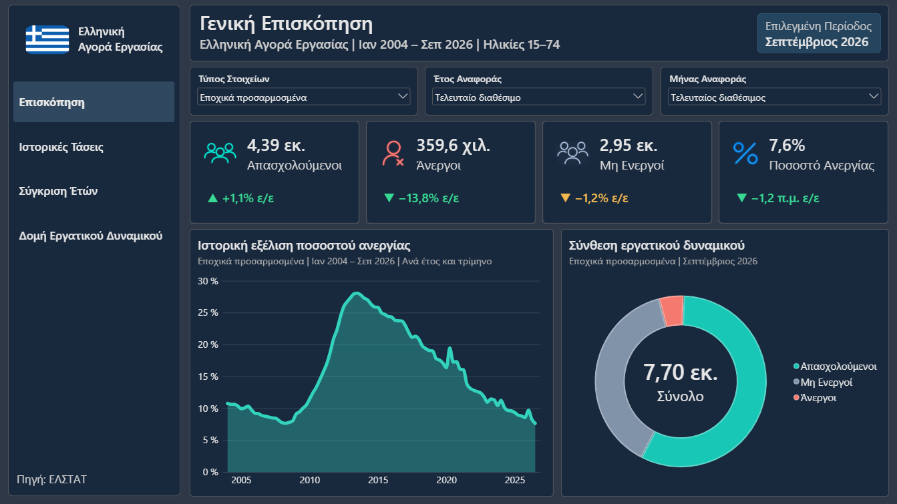
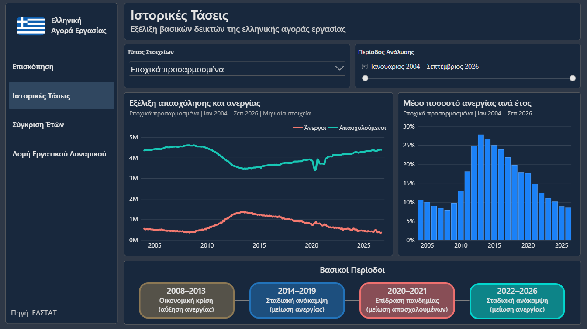
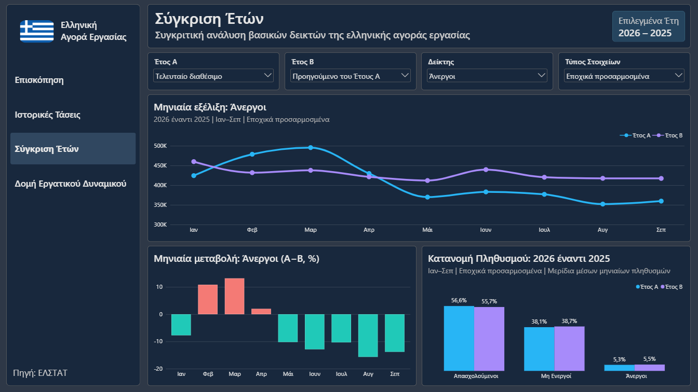
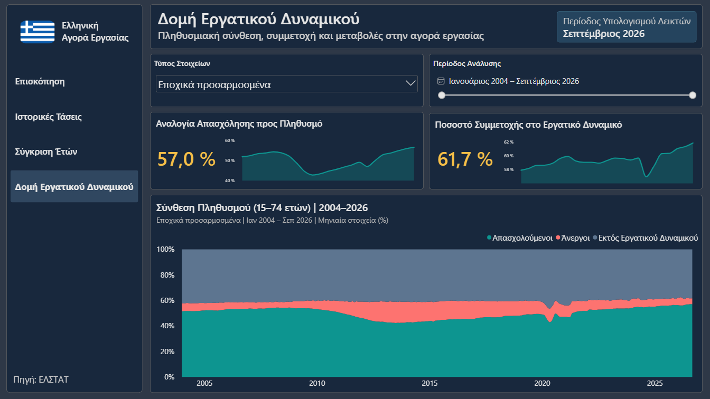
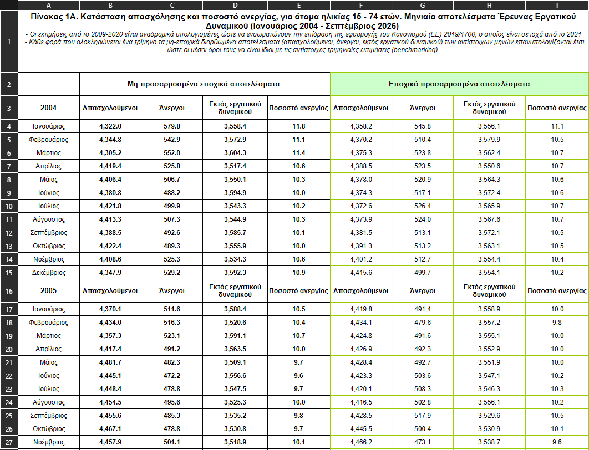
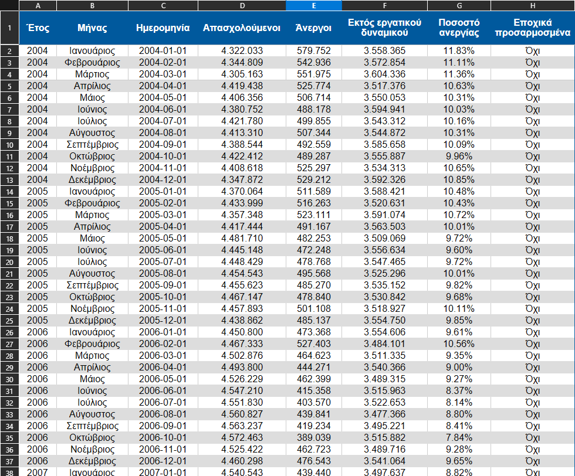

# Greece Labour Market Analysis

**Documentation:** 🇬🇧 **English** | 🇬🇷 [Ελληνικά](README.el.md)

---

## Overview

An interactive **Power BI report** exploring how the Greek labour market has changed from **January 2004 to September 2026**, using monthly data from the **Hellenic Statistical Authority (ELSTAT)**.

The project takes ELSTAT's original Excel time series, restructures them into a clean, analysis-ready dataset, and brings them together in a **four-page dashboard**. It covers employment, unemployment, people outside the labour force, seasonal adjustment, comparisons between years, and changes in the composition of the population aged **15–74**. The dashboard itself is in Greek.

The goal is to go beyond a single unemployment number and show **what changed, when it changed, and how the different labour-market groups relate to one another**.

---

## Table of Contents

- [Overview](#overview)
- [Dashboard Previews](#dashboard-previews)
- [Project Overview](#project-overview)
- [Key Findings](#key-findings)
  - [The economic crisis and peak unemployment](#the-economic-crisis-and-peak-unemployment)
  - [COVID-19: job losses, inactivity and a misleadingly simple unemployment rate](#covid-19-job-losses-inactivity-and-a-misleadingly-simple-unemployment-rate)
  - [Recovery and the latest available figures](#recovery-and-the-latest-available-figures)
  - [Who participates in the labour market?](#who-participates-in-the-labour-market)
- [Dashboard Features](#dashboard-features)
  - [Pages and Interactive Visualizations](#pages-and-interactive-visualizations)
  - [Filters, Dynamic Labels and Comparisons](#filters-dynamic-labels-and-comparisons)
- [Data Source](#data-source)
- [Data Cleaning and Preparation](#data-cleaning-and-preparation)
  - [Original vs. Cleaned Data](#original-vs-cleaned-data)
- [Tools and Techniques](#tools-and-techniques)
- [Project Structure](#project-structure)
- [Roadmap / TODO](#roadmap--todo)
- [Project Status](#project-status)

---

## Dashboard Previews

The four Power BI pages use a consistent midnight-blue theme and Greek labels. **Click any screenshot to open it at full size.**

<table>
  <tr>
    <th align="center" width="50%">Executive Overview (Γενική Επισκόπηση)</th>
    <th align="center" width="50%">Historical Trends (Ιστορικές Τάσεις)</th>
  </tr>
  <tr>
    <td align="center" valign="middle"><a href="assets/dashboard-overview.png"></a></td>
    <td align="center" valign="middle"><a href="assets/dashboard-historical-trends.png"></a></td>
  </tr>
  <tr>
    <td align="center"><sub>Latest figures, year-over-year changes and population composition</sub></td>
    <td align="center"><sub>Monthly employment/unemployment series and annual unemployment rates</sub></td>
  </tr>
  <tr>
    <th align="center">Year Comparison (Σύγκριση Ετών)</th>
    <th align="center">Workforce Structure (Δομή Εργατικού Δυναμικού)</th>
  </tr>
  <tr>
    <td align="center" valign="middle"><a href="assets/dashboard-year-comparison.png"></a></td>
    <td align="center" valign="middle"><a href="assets/dashboard-workforce-structure.png"></a></td>
  </tr>
  <tr>
    <td align="center"><sub>Compare any two years across four labour-market indicators</sub></td>
    <td align="center"><sub>How the population is divided into employed, unemployed and inactive</sub></td>
  </tr>
</table>

---

## Project Overview

The dataset contains **273 months** (January 2004–September 2026), with **two series per month**, seasonally adjusted and unadjusted, for **546 month/series records**.

| Indicator | September 2026, seasonally adjusted |
| --- | ---: |
| **Employed people** | **4,391,208** (~4.39 million) |
| **Unemployed people** | **359,609** (~359.6 thousand) |
| **Outside the labour force** | **2,949,072** (~2.95 million) |
| **Unemployment rate** | **7.6%** |
| **Labour-force participation rate** *(derived)* | **61.7%** |
| **Employment-to-population ratio** *(derived)* | **57.0%** |

The first four figures are from ELSTAT's **September 2026 monthly release**; the final two are calculated from the three population categories. **2026 is a partial year in this dataset (January–September).** All population shares in this report use the dataset's **15–74-year-old reference population**, not everyone living in Greece.

---

## Key Findings

The historical findings below use the **seasonally adjusted monthly series**, unless a different comparison is explicitly identified. Figures are rounded where appropriate; annual figures are averages of monthly observations, not sums of people across months.

### The economic crisis and peak unemployment

The labour market deteriorated sharply during Greece's economic crisis. In the **current data series, unemployment peaked at 28.3% in July 2013**, when approximately **1.37 million people were unemployed** and only **3.46 million were employed**.

For comparison, in **July 2008**, the unemployment rate was **7.6%**, with approximately **379,800 unemployed** and **4.59 million employed**. By July 2013, the number of employed people had fallen by around **1.13 million**, while the unemployment rate was **20.7 percentage points higher**.

This is the most striking turning point in the historical trends chart: a sustained loss of employment alongside a dramatic increase in unemployment. The values reflect the latest series used by this project; historical ELSTAT releases may show slightly different figures because monthly estimates are revised.

### COVID-19: job losses, inactivity and a misleadingly simple unemployment rate

The pandemic produced a different kind of disruption. Looking at the **annual averages of the seasonally adjusted monthly data**, the unemployment rate was about **17.9% in 2019** and **17.6% in 2020** slightly *lower*, despite a steep fall in employment. Over those same years:

| Monthly-series annual average | 2019 | 2020 | Approximate change |
| --- | ---: | ---: | ---: |
| **Employed** | 3.89 million | 3.70 million | **−183,000** |
| **Outside the labour force** | 3.20 million | 3.40 million | **+200,000** |
| **Unemployment rate** | 17.9% | 17.6% | **−0.3 percentage points** |

The sudden change is especially visible between **February and May 2020**: employment dropped from approximately **3,849,300 to 3,392,600** (**−456,700**), while the inactive population rose from **3,330,100 to 3,672,900** (**+342,800**). The monthly unemployment rate **did increase during this interval**, from **15.8% to 19.6%**.

The key insight is that **the unemployment rate alone did not capture the full shock**. ELSTAT's separate quarterly release likewise reported **16.7% unemployment in Q2 2020 versus 16.9% in Q2 2019**, alongside **2.8% fewer employed people** and a **3.4% rise in inactivity**. People who are not working and are not actively seeking work or are not available to start work are classified as outside the labour force rather than unemployed; temporary job absences also complicate the picture. These population counts **do not directly trace individuals moving between categories**.

### Recovery and the latest available figures

From the crisis peak to **September 2026**, the seasonally adjusted unemployment rate fell from **28.3% to 7.6%** (**−20.7 percentage points**). Employment recovered from approximately **3.46 million to 4.39 million** (**+927,000 people**), while unemployment fell from around **1.37 million to 359,600**.

The most recent year-over-year comparison is also positive: compared with **September 2025**, September 2026 recorded **49,573 more employed people (+1.1%)**, **57,627 fewer unemployed people (−13.8%)**, and a **1.2-percentage-point reduction** in the unemployment rate (**8.8% → 7.6%**).

Unemployment is now **close to its pre-crisis levels** (for example, 7.6% in July 2008), although this does **not** mean that every aspect of the labour market has returned to its earlier state: the employed population and the size and composition of the reference population have changed over time.

### Who participates in the labour market?

As of **September 2026**, the three groups add up to approximately **7.70 million people aged 15–74** in the dataset:

| Group | People | Share of reference population |
| --- | ---: | ---: |
| **Employed** | 4,391,208 | **57.0%** |
| **Unemployed** | 359,609 | **4.7%** |
| **Outside the labour force** | 2,949,072 | **38.3%** |
| **Total** | **7,699,889** | **100.0%** |

Together, employed and unemployed people form the **labour force**: about **4.75 million people, or 61.7% of the reference population**. The remaining **38.3%** are outside the labour force, a group that can include students, retirees, caregivers and others who are neither working nor actively seeking and available for work. **The dataset does not provide a breakdown of their individual reasons for inactivity.**

One more useful distinction: **4.7%** is the share of the *entire reference population* that is unemployed, while **7.6%** is the official *unemployment rate*, calculated only among economically active people (employed + unemployed). These are different denominators and should not be confused.

---

## Dashboard Features

### Pages and Interactive Visualizations

| Page / Feature | What it shows | Preview |
| --- | --- | --- |
| **Executive Overview (Γενική Επισκόπηση)** | Four KPI cards for employment, unemployment, inactivity and unemployment rate; year-over-year changes; a historical unemployment trend; and a donut chart for the selected month's population composition. | [View page](assets/dashboard-overview.png) |
| **Historical Trends (Ιστορικές Τάσεις)** | Monthly employment and unemployment on the same time axis, annual average unemployment rates, a date-range selector and a timeline of major historical periods. | [View page](assets/dashboard-historical-trends.png) |
| **Year Comparison (Σύγκριση Ετών)** | Select Year A and Year B, switch between four indicators, compare monthly lines, view diverging month-by-month changes and compare population-category shares. Incomplete years use the **same available months** for a fair comparison. | [View page](assets/dashboard-year-comparison.png) |
| **Workforce Structure (Δομή Εργατικού Δυναμικού)** | A 100% stacked area chart showing employed, unemployed and inactive shares over time, plus compact indicators and sparklines for labour-force participation and the employment-to-population ratio. | [View page](assets/dashboard-workforce-structure.png) |

### Filters, Dynamic Labels and Comparisons

- **Seasonal adjustment:** Switch between *Εποχικά προσαρμοσμένα* and *Μη εποχικά προσαρμοσμένα* results.
- **Month and year selection:** Choose a reporting period on the Overview page; KPI values and the donut chart use that month, with automatic latest-available choices.
- **Historical date range:** Focus on a specific period in the Historical Trends and Workforce Structure pages.
- **Year A / Year B / indicator:** Compare any two available years using employment, unemployment, population outside the labour force or unemployment rate.
- **Correct units:** Unemployment-rate differences use **percentage points (pp)**; relative changes in population counts use **percentages (%)**.
- **Dynamic titles, subtitles and KPI formats:** Labels adapt to the selected dates, series and indicators; large populations are displayed in thousands or millions for readability.
- **Consistent navigation and visuals:** A Greek-language left navigation panel, a shared dark theme and consistent category colours across report pages.

---

## Data Source

**Primary source:** [Hellenic Statistical Authority (ELSTAT)](https://www.statistics.gr/) *Labour Force Survey, monthly data*

- [01A. Employment status and unemployment rate (January 2004 – September 2026)](https://www.statistics.gr/el/statistics/-/publication/SJO02/-)

The data include both **seasonally adjusted** and **unadjusted** observations. Estimates may be revised by ELSTAT as additional survey information becomes available. The source workbook also notes methodological changes affecting parts of the historical series; comparisons should be read as descriptive, not causal.

---

## Data Cleaning and Preparation

The original `.xls` file is kept alongside a cleaned `.xls` dataset. The cleaning and restructuring were carried out in **Microsoft Excel** before importing the data into **Power BI Desktop**.

1. **Restructure ELSTAT's publication layout:** Turn year-by-year blocks and separate adjusted/unadjusted sections into one consistent rectangular table.
2. **Create proper monthly dates:** Keep one real date for each observation in `YYYY-MM-01` form; the day `01` identifies the *month*, not a daily observation.
3. **Standardize numerical values:** Convert population figures reported in *thousands* into person-count units for analysis, and store unemployment rates as decimal proportions for percentage formatting.
4. **Preserve both series:** Keep a clear field for adjusted versus unadjusted observations instead of mixing them.
5. **Validate and prepare:** Check the original/processed records and structure, then implement Power BI calculations using monthly averages or point-in-time values rather than summing population estimates across months.
6. **Model calculations in DAX:** Create measures for period selection, year-over-year changes, labour-force composition, participation rates, consistent chart measures and context-aware subtitles.

**Precision note:** ELSTAT's published time-series tables often round population estimates to *thousands with one decimal place*. Multiplying those values by 1,000 changes the **unit**, not the statistical precision. Extremely precise-looking converted headcounts should not be interpreted as exact person-by-person counts.

### Original vs. Cleaned Data

**Click either image to inspect it at full size.**

<table>
  <tr>
    <th align="center" width="50%">Original ELSTAT time-series workbook</th>
    <th align="center" width="50%">Cleaned, analysis-ready dataset</th>
  </tr>
  <tr>
    <td align="center" valign="middle"><a href="assets/table-original.png"></a></td>
    <td align="center" valign="middle"><a href="assets/cleaned_dataset_screenshot.png"></a></td>
  </tr>
</table>

---

## Tools and Techniques

- **Microsoft Excel:** Cleaning, reshaping and validating the source `.xls` data.
- **Power BI Desktop:** Data import, modelling, visual interactions, slicers, report pages and custom dark-theme design.
- **DAX:** Time-aware measures, dynamic KPI values, annual comparisons, context-sensitive labels and population-share calculations.
- **Git & GitHub:** Version control and sharing the original data, processed data, documentation and Power BI report.

---

## Project Structure

```text
.
├── assets/
│
├── dashboard/
│   └── Greece_Labour_Market_Analysis.pbix
│
├── data/
│   ├── raw/                       # Original ELSTAT workbook (.xls)
│   └── processed/
│
├── .gitignore
├── LICENSE
├── README.el.md                   # Greek documentation
└── README.md                      # English documentation
```

---

## Roadmap / TODO

- [x] Restructure and clean the historical monthly ELSTAT dataset.
- [x] Build the four-page Greek-language Power BI dashboard.
- [x] Add interactive period, adjustment, year-comparison and indicator selectors.
- [x] Document findings and provide English/Greek project documentation.
- [ ] Add future ELSTAT months and publish refreshed dashboard screenshots as the series is updated.
- [ ] Automate repeatable source-file validation and refresh steps.
- [ ] Optionally add language switching *inside* the Power BI report; the dashboard currently uses Greek labels.

---

## Project Status

**Current release:** Completed **four-page Power BI report**, covering **January 2004–September 2026**, with the original and cleaned data and bilingual GitHub documentation.

**Maintenance:** The dataset and report are a snapshot as of **September 2026**. New ELSTAT releases and revisions can be incorporated by updating the source data, refreshing Power BI and rechecking the reported findings.
